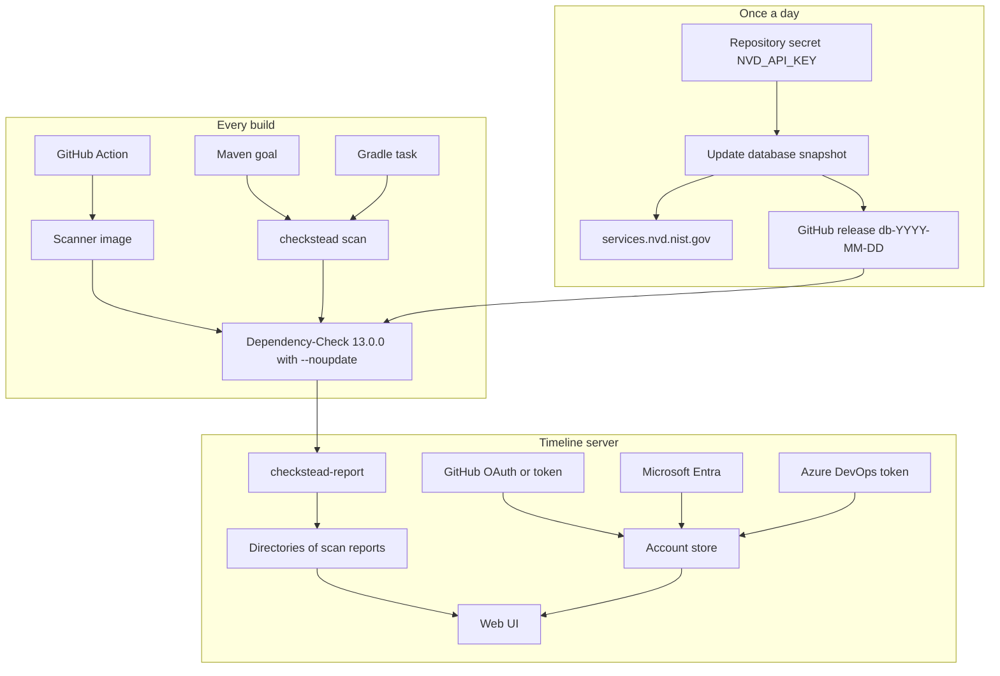

# Checkstead

Checkstead runs [OWASP Dependency-Check](https://owasp.org/projects/dependency-check) once, the same way, for every build. One updater publishes a database snapshot. Scans use that snapshot. A scan does not use an NVD API key and does not call `services.nvd.nist.gov`.

[](https://github.com/chethankumblekar/dependency-check-db-cache/actions/workflows/ci.yml)
[](LICENSE)
[](https://github.com/dependency-check/DependencyCheck/releases/tag/v13.0.0)
[](pyproject.toml)

This product uses data from the NVD API but is not endorsed or certified by the NVD.

Checkstead is not an OWASP project and does not speak for OWASP or NIST.

## Setup

```bash
curl -fsSL https://raw.githubusercontent.com/chethankumblekar/dependency-check-db-cache/main/scripts/setup.sh | bash
```

Run that command again when a finished scan still exits 14. Python, Java, and the engine stay in place.

## Run

Open a new terminal.

```bash
checkstead scan --scan . --project my-service
```

Reports are written to `checkstead-report/`.

A project virtualenv has its own `checkstead`. Install into that environment, then run the same command:

```bash
python -m pip install --upgrade --force-reinstall --no-cache-dir https://github.com/chethankumblekar/dependency-check-db-cache/archive/refs/heads/main.tar.gz
checkstead scan --scan . --project my-service
```

| | |
| --- | --- |
| Name | Checkstead |
| Repository | [chethankumblekar/dependency-check-db-cache](https://github.com/chethankumblekar/dependency-check-db-cache) |
| Maintainer | Chethan K ([@chethankumblekar](https://github.com/chethankumblekar)) |
| License | [Apache-2.0](LICENSE) |
| Engine | OWASP Dependency-Check 13.0.0 |
| Version | 0.1.0 |

## Contents

- [Setup](#setup)
- [Run](#run)
- [Screenshots](#screenshots)
- [Architecture](#architecture)
- [What this release does](#what-this-release-does)
- [Pinned engine](#pinned-engine)
- [Scan](#scan)
- [What a scan still contacts](#what-a-scan-still-contacts)
- [The updater secret](#the-updater-secret)
- [Container images](#container-images)
- [Maven](#maven)
- [Gradle](#gradle)
- [GitHub Action](#github-action)
- [Azure DevOps](#azure-devops)
- [Release](#release)
- [Timeline](#timeline)
- [Server](#server)
- [Develop](#develop)
- [License and security](#license-and-security)

## Screenshots

The pictures are the timeline server, signed in against the two fixture scans that ship in `ui/scans`. Both scans used the same snapshot. Finding analysis did not run, so the findings list and the score source are empty on purpose.

Sign in with GitHub, with a Microsoft Entra work or school account, or with a personal access token. GitLab is not connected.


The timeline names the snapshot, the engine, the revision, and the person git recorded for that revision. The drift between the two fixture scans is guava 31.1-jre to 32.1.3-jre. commons-lang3 left, and gson arrived.


The first person to sign in is the administrator. Administration is where that person adds later accounts.


## Architecture

A scan and the timeline server are separate. The scan never holds an NVD API key. The updater is the only job that talks to `services.nvd.nist.gov`.



Pushing this repository runs [CI](.github/workflows/ci.yml). That workflow lints, builds, and tests. After those pass, it publishes the scanner image and the server image. A pull request builds the images and does not push them.

| Path | Role |
| --- | --- |
| `src/checkstead` | Scan client, account store, and timeline server |
| `engine.version` | The Dependency-Check pin |
| `checkstead.yml` | Snapshot URL, plus fields reserved for later |
| `Dockerfile` | Scanner image |
| `Dockerfile.server` | Timeline server image |
| `action.yml` | GitHub Action that runs the scanner image |
| `integrations/azure-devops` | Azure DevOps extension and pipeline task |
| `integrations/maven` | Maven goal that calls `checkstead scan` |
| `integrations/gradle` | Gradle task that calls `checkstead scan` |
| `ui/scans` | The two fixture scans shown above |
| `.github/workflows/ci.yml` | Lint, test, build, and image publish |
| `.github/workflows/update-snapshot.yml` | Daily snapshot |

## What this release does

| In this release | Later |
| --- | --- |
| Pinned scan, checksummed snapshot, `--noupdate` | Public suppression rules confirmed by more than one user |
| Named score policy, threshold, KEV flag, and a no-score line | |
| Private suppression file, kept local | |
| Timeline of scans and the drift between them | Suppression and false-positive records |
| Git author on a scan when that commit is in the tree | |
| Server accounts: GitHub, Microsoft Entra, Azure DevOps | GitLab and other Git hosts |

`scorePolicy` chooses the one score a finding is judged on. `threshold` fails the build when that score is at or above the number. An empty threshold does not fail on score. `failOnKev` fails on a CISA KEV finding even when the score is below the threshold. `failUnscored` fails when a finding has no score. `privateSuppressions` is a local file passed to the engine. A URL is refused, and the file is not published. The timeline does not invent suppression or false-positive records.

## Pinned engine

The pin is Dependency-Check **13.0.0**, the current upstream release on 6 October 2026 ([v13.0.0](https://github.com/dependency-check/DependencyCheck/releases/tag/v13.0.0), published 3 August 2026). Release 12.2.2 changed the database schema, so a database built by an older engine is not usable here. The pin is the single line in [`engine.version`](engine.version). Move it when upstream changes behavior or the database schema.

A snapshot manifest names the engine that built it. If that version is not the pin, the scan stops and does not run Dependency-Check.

## Scan

[Setup](#setup) installs only what is missing, without sudo, under `$HOME/checkstead`. [Run](#run) is the scan. The first scan downloads the published snapshot. Setup does not call the NVD and does not ship a database.

From a checkout, the same script is `bash scripts/setup.sh`. `checkstead version` prints `13.0.0`.

Put [`checkstead.yml`](checkstead.yml) in the project you scan, or use the copy in this repository.

```yaml
snapshot: https://github.com/chethankumblekar/dependency-check-db-cache/releases/latest/download/manifest.json
scorePolicy: prefer-newest
threshold: 7
failOnKev: false
failUnscored: false
privateSuppressions:
```

`snapshot` is the manifest URL. `releases/latest` on this repository is the Checkstead snapshot, the release that contains `manifest.json`. The daily updater publishes `db-YYYY-MM-DD` and marks that release latest.

`prefer-newest` uses an NVD score when the report has one. Otherwise it uses a CNA score, and otherwise another analyzer in the report. The newer CVSS version from that source is the one that counts. `highest` uses the largest base score from any source. The report names the version, the score, the vector, and the source. A KEV finding stays in the report when its score is below the threshold. A finding with no score is a `no score` line, not a pass that hides a missing NVD record.

`privateSuppressions` is optional. Omit it, leave it blank, or name a file that is missing or empty, and the scan runs with no private rules. When that local file contains rules, those rules are applied. A URL is refused. Expired rules and CVE rules that matched nothing are listed in `checkstead.txt`. Checkstead does not ship a confirmed public rule. Upstream hosted suppressions stay the ones in the snapshot.

```bash
checkstead scan --scan . --project my-service
```

The report directory is `checkstead-report/`. `checkstead.txt` names the engine and the snapshot:

```text
engine: 13.0.0
snapshot: 2026-10-06T01:00:00Z
checksum: sha256:…
notice: This product uses data from the NVD API but is not endorsed or certified by the NVD.
score-policy: prefer-newest
threshold: 7
```

Pass `--revision` when the scan should name a git commit. If that commit is in the tree you scanned, the report also names the author git recorded.

The same directory receives Dependency-Check's HTML and JSON reports. The command is the pinned `dependency-check.sh` with that snapshot's data directory and `--noupdate`. It does not receive `--nvdApiKey`.

The first scan of a UTC day downloads the manifest and the database zip, checks the engine version and the SHA-256 checksum, and caches them under `~/.cache/checkstead/<UTC date>/`. A later scan that day uses the cache, so both scans name the same snapshot even if the published manifest changes. Set `CHECKSTEAD_CACHE` to put that cache somewhere else.

The public URL above is that latest manifest. This project does not ship a made-up database.

## What a scan still contacts

`--noupdate` turns off Dependency-Check 13.0.0's update phase. That phase is what calls `services.nvd.nist.gov`. It is also what refreshes CISA KEV, the hosted suppressions file, the RetireJS repository, and the engine version check. Those copies are whatever the snapshot already contains.

Analysis can still open other connections when the files you scan need them:

- Maven Central (`search.maven.org`), when a jar has no POM metadata beside it
- npm, yarn, and pnpm audit (`registry.npmjs.org`), when those manifests are in the scan
- the other ecosystem audit analyzers, when their manifests are in the scan

OSS Index is on in the engine defaults and turns itself off when no Sonatype token is configured. Checkstead does not set one.

The Maven goal and the Gradle task pass the coordinates and the jars the build already resolved, which is the path that needs Central less often.

## The updater secret

Scans do not use an NVD API key. The daily updater does. It is the only place the key is read.

Add one repository secret:

| Name | What to put there |
| --- | --- |
| `NVD_API_KEY` | An NVD API key for this requestor. Request one at <https://nvd.nist.gov/developers/request-an-api-key>. |

Do not copy a key out of another repository. Do not put this secret in a scan, a `checkstead.yml`, or an application repository.

Until the secret is set, [Update database snapshot](.github/workflows/update-snapshot.yml) fails on purpose and publishes nothing. After it is set, run that workflow once, or wait for the schedule at 01:00 UTC. The job installs Dependency-Check 13.0.0, refuses the binary if it does not report that version, runs `--updateonly` with the key, and publishes a GitHub release tagged `db-YYYY-MM-DD`, marked latest. The release contains:

- `manifest.json` — engine version, UTC timestamp, SHA-256 checksum
- `checkstead-db.zip` — the data directory
- `checkstead-db.zip.sha256`

A second run on the same UTC day leaves that release in place and does not call NVD again. The workflow allows three hours. The first database load is large.

## Container images

The scanner image contains the pinned engine and the `checkstead` command. It does not contain a database. The server image is the timeline only.

You can build them from this checkout:

```bash
docker build -t checkstead .
docker run --rm -v "$PWD:/work" -w /work checkstead scan --scan . --project my-service
```

[CI](.github/workflows/ci.yml) publishes both images to GitHub Container Registry after the tests pass.

| Image | What it is |
| --- | --- |
| `ghcr.io/chethankumblekar/dependency-check-db-cache/checkstead` | Scanner. The pinned engine and the `checkstead` command. |
| `ghcr.io/chethankumblekar/dependency-check-db-cache/checkstead-server` | Timeline server. |

| Tag | When it is published |
| --- | --- |
| `sha-<commit>` | Every push. The commit is the full git SHA, so this tag stays on that build. |
| `<branch>` | Pushes to that branch. The default branch tag is `main`. |
| `latest` | Pushes to the default branch. |
| `engine-13.0.0` | Pushes to the default branch, scanner image only. The number is the pin in `engine.version`. |
| `0.1.0`, `0.1`, and `v0.1.0` | A git tag named `v0.1.0`. |

```bash
docker pull ghcr.io/chethankumblekar/dependency-check-db-cache/checkstead:latest
docker pull ghcr.io/chethankumblekar/dependency-check-db-cache/checkstead-server:latest
```

The first publish creates the packages. If a pull is denied, open the package on GitHub and set its visibility to public.

## Maven

The goal shells out to `checkstead scan` and passes `group:artifact:version` plus the resolved jar files. Install it from this repository:

```bash
mvn -f integrations/maven/pom.xml install
```

`checkstead` must be on `PATH` where the build runs.

```xml
<plugin>
  <groupId>dev.checkstead</groupId>
  <artifactId>checkstead-maven-plugin</artifactId>
  <version>0.1.0</version>
  <executions>
    <execution>
      <goals>
        <goal>scan</goal>
      </goals>
    </execution>
  </executions>
</plugin>
```

The goal is `checkstead:scan`, bound to `verify`. Override the scan path with `-Dcheckstead.scan=...` or the config file with `-Dcheckstead.config=...`.

## Gradle

Apply the script plugin. It registers `checksteadScan`, which calls the same command with the project coordinates and the runtime classpath.

```groovy
apply from: "integrations/gradle/checkstead.gradle"
```

From another repository, copy `integrations/gradle/checkstead.gradle` or apply the raw file from a tag of this repository. `checkstead` must be on `PATH`.

## GitHub Action

`action.yml` in this repository builds the scanner image and runs `checkstead scan`. It has no API key input. The report is written to `checkstead-report/` in the workspace.

```yaml
name: Scan
on: [push]
jobs:
  scan:
    runs-on: ubuntu-latest
    steps:
      - uses: actions/checkout@v5
      - uses: chethankumblekar/dependency-check-db-cache@main
        with:
          scan: .
          project: my-service
```

Pin a commit SHA when the scan should stay on one build. `@main` follows this repository. After a version tag, `v0` follows the newest 0.x release. See [Release](#release).

## Azure DevOps

The extension in [`integrations/azure-devops`](integrations/azure-devops) adds the pipeline task `ChecksteadScan`. It runs the same scanner image. It does not take an NVD API key. The agent needs Docker.

```yaml
- task: ChecksteadScan@0
  inputs:
    scan: .
    project: $(Build.Repository.Name)
```

A full example is [`integrations/azure-devops/example.yml`](integrations/azure-devops/example.yml). GitHub builds use the Action above. The [Release](#release) workflow publishes this extension, and an Azure Pipelines organization installs that public listing before it uses the task.

## Release

Push a tag `v0.1.0`. [Release](.github/workflows/release.yml) runs on tags that look like `v1.2.3`.

It creates the GitHub release, moves the floating tags `v0` and `v0.1` to that commit, attaches the Azure DevOps extension package, and publishes that package to the Azure DevOps Marketplace. CI on the same tag publishes the scanner image `ghcr.io/chethankumblekar/dependency-check-db-cache/checkstead:0.1.0`.

GitHub Marketplace has no API for its listing checkbox. On the first release, edit it, select **Publish this Action to the GitHub Marketplace**, and set the primary category to **Security**. The account needs the Marketplace Developer Agreement and two-factor authentication. Later tags stay on that listing.

The Release workflow publishes the extension. Set both of these on the repository before the first tag. The manifest already has `"public": true`.

| Name | Kind | What to put there |
| --- | --- | --- |
| `AZURE_MARKETPLACE_TOKEN` | Secret | A personal access token with Marketplace (Publish). Organization: All accessible organizations. Create it at [the token page](https://dev.azure.com/_usersSettings/tokens). |
| `AZURE_MARKETPLACE_PUBLISHER` | Variable | The publisher id from [the Marketplace publisher hub](https://marketplace.visualstudio.com/manage). Create that publisher with a Microsoft account. |

The token page can offer to create an organization so the token has a home. The Release workflow on GitHub is what publishes. Teams that already use Azure Pipelines open the listing and choose **Get it free**, then use `ChecksteadScan@0`. Their agent pulls the scanner image, so the GHCR package has to be public. See [Container images](#container-images).

Microsoft lists a public extension when the publisher is verified. On the publisher **Details** tab, verify a domain you control if the page asks for that. Microsoft may also review the listing.

If the secret or the variable is missing, the publish step fails.

## Timeline

```bash
python3 -m checkstead ui
```

Open http://127.0.0.1:8765/. The page reads `ui/scans`. Pass `--scans` to point it at another directory of scan reports.

The two reports already in `ui/scans` are a pair of fixture scans on the same snapshot (`2026-10-06T01:02:03Z`, engine 13.0.0). Dependency-Check 13.0.0 identified the jars in evidence-collection mode: guava 31.1-jre and commons-lang3 3.12.0, then guava 32.1.3-jre and gson 2.10.1. Those jars are the published Maven Central artifacts. Finding analysis did not run, because that needs the NVD snapshot and this checkout does not contain one. The findings list and the score-source field are empty. Suppressions and false positives are empty on purpose.

A scan records a revision when you pass `--revision`. When that revision is a commit in the tree you scanned, the report also names the person git recorded as the author. The sample reports use the commits of the fixture trees. Both were committed by Cursor Agent.

## Server

The timeline is a server you can run on a laptop or deploy as a container. People can sign in with GitHub, with a Microsoft Entra work or school account, or with a GitHub or Azure DevOps personal access token. The server asks that host who the person is, then discards the token. It does not keep a copy.

On a laptop, from this checkout:

```bash
PYTHONPATH=src python3 -m checkstead ui
```

Open http://127.0.0.1:8765/. Accounts are stored under `~/.local/share/checkstead`, or in the directory you pass with `--data`.

The container is the same server, listening on every interface so it can be deployed on a host you choose:

```bash
docker build -f Dockerfile.server -t checkstead-server .
docker run --rm -p 8765:8765 -v checkstead-data:/var/lib/checkstead checkstead-server
```

The published server image is the same container:

```bash
docker pull ghcr.io/chethankumblekar/dependency-check-db-cache/checkstead-server:latest
docker run --rm -p 8765:8765 -v checkstead-data:/var/lib/checkstead ghcr.io/chethankumblekar/dependency-check-db-cache/checkstead-server:latest
```

The scan image can start it too, with `docker run --rm -p 8765:8765 checkstead ui --host 0.0.0.0`. That image also contains the scanner. `Dockerfile.server` is only the server.

Single sign-on needs an app registration. Leave the variables unset and the buttons stay on the page, marked not configured, and a personal access token still works.

| Variable | What it is |
| --- | --- |
| `CHECKSTEAD_GITHUB_CLIENT_ID` | GitHub OAuth app client id |
| `CHECKSTEAD_GITHUB_CLIENT_SECRET` | GitHub OAuth app client secret |
| `CHECKSTEAD_GITHUB_ORG` | Optional. When set, only members of this GitHub organization can use the GitHub button. |
| `CHECKSTEAD_ENTRA_CLIENT_ID` | Entra app registration client id |
| `CHECKSTEAD_ENTRA_CLIENT_SECRET` | Entra app registration client secret |
| `CHECKSTEAD_ENTRA_TENANT` | Optional. Defaults to `organizations`, which is work and school accounts. Set a tenant id to lock one organization. |

The redirect URLs are `https://<host>/api/sso/github/callback` and `https://<host>/api/sso/entra/callback`. On a laptop without TLS they are `http://127.0.0.1:8765/...`. Set `CHECKSTEAD_COOKIE_SECURE=1` when the server is behind TLS.

Create a token for the host you use:

| Host | What to create | What the server asks |
| --- | --- | --- |
| GitHub | A personal access token that can read your user. A classic token needs the `read:user` scope. | `https://api.github.com/user` |
| Azure DevOps | A personal access token for the organization, and the organization name on the sign-in form. | `https://dev.azure.com/{organization}/_apis/connectionData` |

The first person to sign in becomes the administrator. After that, Administration is where that person adds logins and chooses who is a user and who is an administrator. Someone who has not been added cannot sign in. The last administrator cannot be removed.

GitLab and other Git hosts are not connected. Adding one is a new identity provider beside GitHub and Azure DevOps. The server does not pretend they are available.

Put the server behind TLS when it is not on your own machine, and set `CHECKSTEAD_COOKIE_SECURE=1` so the session cookie is marked Secure. Do not bake a token into the image or the repository.

## Develop

```bash
python3 -m pip install ruff==0.14.2 build==1.3.0 certifi
bash scripts/self-test.sh
```

That is the same lint, package build, unit tests, and Maven plugin tests that CI runs before it publishes images. The tests publish no database. They serve a tiny zip, run two scans on the same UTC day, and record every URL the scan client requests. Both reports name the same snapshot. None of the requests are to `services.nvd.nist.gov`. A manifest built by engine 12.1.8 is refused before the zip is downloaded.

## License and security

Checkstead is [Apache-2.0](LICENSE). Contributions use the Developer Certificate of Origin. See [CONTRIBUTING.md](CONTRIBUTING.md).

Maintainer: Chethan K ([@chethankumblekar](https://github.com/chethankumblekar)). Report a vulnerability through [SECURITY.md](SECURITY.md). You can email chethan.kumblekar@ascertra.com, or open a private advisory:

https://github.com/chethankumblekar/dependency-check-db-cache/security/advisories/new
