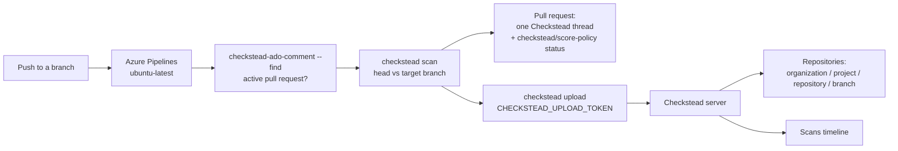

# Checkstead with Azure DevOps

Checkstead works with Azure DevOps the way SonarQube does. A pipeline step scans the repository and sends the report to the Checkstead server. The server learns the organization, project, repository, branch, and pull request from that report. It never needs access to the organization. Nobody pastes a personal token.

This page covers the whole setup: the server, upload tokens, the pipeline, pull request comments and statuses, the **Repositories** page, and who can sign in. [Azure on Ubuntu and Windows](azure.md) has the platform-specific steps: App Service, the file share, and Windows agents.

## Contents

- [How it fits together](#how-it-fits-together)
- [Quick start](#quick-start)
- [Server](#server)
- [Upload tokens](#upload-tokens)
- [Pipeline](#pipeline)
- [What a pull request shows](#what-a-pull-request-shows)
- [Repositories page](#repositories-page)
- [CI runs page](#ci-runs-page)
- [Who can sign in](#who-can-sign-in)
- [Optional: list every branch with a service principal](#optional-list-every-branch-with-a-service-principal)
- [Security notes](#security-notes)
- [Troubleshooting](#troubleshooting)
- [How this was verified](#how-this-was-verified)

## How it fits together



- **Pull request feedback** comes from the pipeline itself, with the pipeline's own `System.AccessToken`. Checkstead does not need to reach Azure DevOps for it.
- **Repositories and branches** come from the reports pipelines send. A report carries `repository-url` (from `Build.Repository.Uri`) and `build-url`.
- **Scans of local checkouts** have no repository URL. They show on **Scans** and never on **Repositories**.

## Quick start

1. Run the server and sign in. The first person to sign in becomes the administrator. See [Server](#server).
2. Open **Access > Upload tokens**, name a token, and copy it. It is shown once.
3. Add a [variable group](https://learn.microsoft.com/azure/devops/pipelines/library/variable-groups) with these two variables, and link it to the pipelines:
   - `CHECKSTEAD_SERVER`: the server origin, such as `https://checkstead.example`.
   - `CHECKSTEAD_UPLOAD_TOKEN`: the token. Mark it secret.
4. Copy [`integrations/azure-devops/pr-ci.yml`](../integrations/azure-devops/pr-ci.yml) into the repository. Change its `trigger:` to the branches you want, and create a pipeline from it.
5. Make sure the build service has **Contribute to pull requests** on the repository. See [Permissions](#permissions).
6. Push a branch and open a pull request. The next push runs the scan, comments on the pull request, posts a status, and sends the report. The repository appears under **Repositories**.

## Server

The server is `ghcr.io/chethankumblekar/dependency-check-db-cache/checkstead-server`, or `checkstead ui` from a checkout. For a server other people use:

| Variable | Value |
| --- | --- |
| `CHECKSTEAD_PUBLIC_BASE` | The origin people and pipelines use, such as `https://checkstead.example`. |
| `CHECKSTEAD_COOKIE_SECURE` | `1` behind TLS. |
| `CHECKSTEAD_LOCAL` | `0`, so nobody gets in without signing in. |
| `CHECKSTEAD_ENTRA_CLIENT_ID`, `CHECKSTEAD_ENTRA_CLIENT_SECRET`, `CHECKSTEAD_ENTRA_TENANT` | Microsoft Entra sign-in. Use the directory (tenant) id. |
| `CHECKSTEAD_ENTRA_ALLOWED_GROUPS`, `CHECKSTEAD_ENTRA_ADMIN_GROUPS` | Optional. See [Who can sign in](#who-can-sign-in). |
| `CHECKSTEAD_MAX_UPLOAD_MB` | Optional. The largest report the server accepts. Default 64. |

Keep the data directory (`/var/lib/checkstead`) and the scans directory (`/var/lib/checkstead/scans`) on persistent storage. The data directory holds the accounts, sessions, and upload token hashes. The scans directory holds the reports pipelines send.

Microsoft-hosted agents reach the server over the internet. An App Service, a container host behind a TLS proxy, or a self-hosted agent on the same network all work. Microsoft-hosted agents come from the [Azure DevOps IP ranges](https://learn.microsoft.com/azure/devops/organizations/security/allow-list-ip-url) if the server sits behind an allowlist.

## Upload tokens

A pipeline sends its report with an upload token, the way a SonarQube analysis is sent with a SonarQube token.

- **Create:** **Access > Upload tokens > Create upload token**. Name it after what uses it, such as `Proarc-Products pipelines`. The token starts with `cks_` and is shown once. Copy it into the secret variable straight away.
- **Store:** the server keeps only the token's SHA-256 hash. The table shows when each token was created and last used.
- **Revoke:** **Revoke**, then **Confirm revoke**. Pipelines using that token get HTTP 401 from then on.
- **API:** `GET` and `POST /api/admin/upload-tokens`, `DELETE /api/admin/upload-tokens/<id>`. Administrators only.

One token per team or variable group keeps a revoke small.

## Pipeline

Two examples ship in [`integrations/azure-devops`](../integrations/azure-devops). Both scan the pull request head against its target branch with one snapshot, keep one Checkstead thread on the pull request, and send the report.

| Example | Runs on | Needs | Gate |
| --- | --- | --- | --- |
| [`pr-ci.yml`](../integrations/azure-devops/pr-ci.yml) | A push (CI trigger) | Nothing beyond the pipeline | A `checkstead/score-policy` status. It blocks only if someone adds a status check policy. |
| [`pull-request.yml`](../integrations/azure-devops/pull-request.yml) | A Build validation branch policy | A project administrator to add the policy | The build itself is the required check. |

Start with `pr-ci.yml` unless you can add branch policies.

### Steps in `pr-ci.yml`

1. **Find the pull request.** `checkstead-ado-comment --find` asks Azure DevOps for the active pull request whose source is the pushed branch. It sets `CHECKSTEAD_PR_ID` and `CHECKSTEAD_PR_TARGET`. With none, the branch is scanned alone.
2. **Checkstead scan.** The pushed commit is scanned. With a pull request, its target branch is scanned too, and only findings the pull request adds count against the score policy. The scan records `--repository-url "$BUILD_REPOSITORY_URI"` and a `--build-url` for this run. A policy failure exits 3, which fails the step.
3. **Comment on the pull request.** It runs only with a pull request, and also after a failed scan. It writes one closed thread and posts the status.
4. **Keep the report on the build.** The report folder is published as a build artifact.
5. **Send the report to Checkstead.** `checkstead upload` sends the report, and runs after a failed scan too. With `CHECKSTEAD_SERVER` or `CHECKSTEAD_UPLOAD_TOKEN` unset, it prints that and does nothing.

### Variables

| Name | Kind | Used by |
| --- | --- | --- |
| `CHECKSTEAD_SERVER` | Variable | Send step. The server origin. |
| `CHECKSTEAD_UPLOAD_TOKEN` | Secret variable | Send step only, mapped with `env:`. Azure Pipelines does not give secrets to scripts otherwise. |
| `checksteadImage` | Pipeline variable in the YAML | Every step. Pin a version or digest for production, not `latest`. |
| `System.AccessToken` | Predefined | The find and comment steps only, mapped with `env:`. |

### Permissions

The comment and status calls run as the pipeline's build identity:

- **Project Collection Build Service (*org*)**, when the project setting *Limit job authorization scope to current project* is off;
- **\<project\> Build Service (*org*)**, when it is on.

That identity needs **Contribute to pull requests** on the repository (Project settings > Repositories > *repository* > Security). It is usually inherited. Without it, the comment step fails with HTTP 403 and names `PullRequestContribute`. The report is still published and sent.

### Branch policy version

`pull-request.yml` reads the pull request from the build validation variables, so it has no lookup step. Add it as a **Build validation** policy on the target branch. Optionally add **Check for comment resolution**: Checkstead creates its thread closed, so it never blocks completion.

## What a pull request shows

- **One thread.** It lists the introduced findings, the findings already on the base, and whether the score policy failed. Later pushes update that thread. Checkstead creates it closed, so a comment resolution policy is not blocked by it. Checkstead only updates a thread it created; those carry a `Checkstead.Report` property the web UI cannot set. If a person types the report marker into their own comment, the build leaves it alone. A deleted Checkstead thread is created again on the next push.
- **A status.** `checkstead/score-policy` is `succeeded` or `failed`, from the job status, and links to the build. To make it required, add a **Status check** policy for that name.

A push made before the pull request was opened has no pull request to comment on. The next push does.

## Repositories page

**Repositories** lists every repository a pipeline has reported, by organization and project:

- **Repository:** links to the repository in Azure DevOps.
- **Newest result:** for `main`, `master`, or `develop`, or else the newest scanned branch. It is **Passes, N findings**, **Fails policy**, or **not scanned**, and links to the scan.
- **Branches:** every scanned branch with its commit, its result, the pull request number when a pull request build sent it, and a link to the pipeline run.
- **Filter:** narrows the list by project or repository name.

The result applies the scan's own score policy (threshold, KEV, unscored) to all of its findings. For a pull request scan, that says whether the head fails on its own.

A repository appears after its first report, and a branch after its first scan. The organization, project, and repository come from `Build.Repository.Uri`. Both `https://dev.azure.com/<org>/<project>/_git/<repo>` and `https://<org>.visualstudio.com/...` work. Organization userinfo in that URL is dropped before it is stored.

## CI runs page

**CI runs** lists GitHub workflow runs when the GitHub App is installed. With the optional service-principal sync below, it also lists recent runs of Azure DevOps pipelines whose name contains `checkstead`. Pipeline reports alone do not list runs. Each branch on **Repositories** links to the run that sent it.

## Who can sign in

- **Microsoft Entra (recommended).** In an organization backed by your Entra tenant, **Sign in with Microsoft** is the same person as their Azure DevOps account. No token is involved.
- **Entra groups.** The server can admit people automatically instead of an administrator adding each one on **Access**. Set `CHECKSTEAD_ENTRA_ALLOWED_GROUPS` (members) and `CHECKSTEAD_ENTRA_ADMIN_GROUPS` (administrators) to group object ids, comma separated. The app registration must send groups in the ID token:

  ```bash
  az ad app update --id <application-id> --set groupMembershipClaims=SecurityGroup
  ```

  Joining an admin group promotes an existing member. Leaving it does not demote, so a group change cannot lock out the last administrator. Someone in more than 200 groups gets a link in place of the list. Checkstead does not follow it, and says so; add that person on **Access**.
- **Azure DevOps token.** An administrator adds an **Azure DevOps** login on **Access**. That person then signs in with the organization name and a PAT with only **User Profile (Read)**. The server checks the PAT once and does not keep it. This suits organizations that are not backed by your Entra tenant.

## Optional: list every branch with a service principal

Pipeline reports list the branches that were scanned. To list every repository and branch, including unscanned ones, and the Checkstead pipeline runs, the server can read the organization as its own Entra application. This needs an organization administrator.

1. Add the application under **Organization settings > Users > Add users** with **Basic** access. Add it to each project to show as a **Reader**. Stakeholder access cannot read repositories.
2. Set `CHECKSTEAD_AZURE_DEVOPS_ORG`, optionally `CHECKSTEAD_AZURE_DEVOPS_PROJECTS`, and a tenant id in `CHECKSTEAD_ENTRA_TENANT`.
3. The server syncs on start and every `CHECKSTEAD_SYNC_MINUTES` (default 15). An administrator can press **Sync now**.

A synced organization is shown once, from the sync, with reported scans matched to its branches. A failed sync keeps the last good list and shows why. Details are in [Azure on Ubuntu and Windows](azure.md#optional-list-every-branch-with-a-service-principal).

## Security notes

- **No macros in scripts.** Azure Pipelines pastes a `$(...)` macro into the script text before bash runs it. A branch named `a$(curl …|sh)` is a valid git ref, and the branch author picks it. The examples read every value from environment variables and use a macro only for an `env:` mapping. A test fails if a `System.`, `Build.`, or `Agent.` macro returns to a script body. A real pipeline run on a branch named `checkstead-test/x$(touch${IFS}/tmp/checkstead-pwned)` ran nothing.
- **Untrusted analyzers off.** The pull request head is scanned with `CHECKSTEAD_UNTRUSTED_SOURCE=1`. That turns off analyzers that run tools from the scanned tree.
- **Least access for each token.** `System.AccessToken` goes only to the find and comment steps. `CHECKSTEAD_UPLOAD_TOKEN` goes only to the send step. Neither is printed.
- **Uploads.** The server checks the upload token before it reads the body and refuses a body over the limit unread. It keeps only Checkstead report files at the top of the zip: no paths, links, or other files. It needs a `checkstead.txt` that parses. A report is written to a dot folder and renamed into place when complete.
- **What is stored.** Repository and build URLs are stored only as https, without credentials, query, or fragment. The build link keeps its `buildId` query.

## Troubleshooting

| Message | Cause and fix |
| --- | --- |
| `The server refused the report: HTTP 401. An upload token is required.` | The token is wrong, revoked, or not mapped. Map it with `env: CHECKSTEAD_UPLOAD_TOKEN: $(CHECKSTEAD_UPLOAD_TOKEN)` and check it on **Access**. |
| `CHECKSTEAD_SERVER or CHECKSTEAD_UPLOAD_TOKEN is not set. The report stays on the build.` | The variable group is not linked, or the secret is unset. |
| `The server refused the report: HTTP 413` | The report is over `CHECKSTEAD_MAX_UPLOAD_MB`. |
| `pull request comment failed: HTTP 403 … PullRequestContribute` | The build identity lacks **Contribute to pull requests**. See [Permissions](#permissions). |
| `This pipeline scans pull requests.` | `pull-request.yml` was run without a pull request. Use `pr-ci.yml`, or run it from a Build validation policy. |
| `no active pull request from refs/heads/…` | Expected on a push before the pull request exists. The next push comments. |
| `--enable-file-backup-request-intent is required for file share OAuth` | Only for the file share copy in [azure.md](azure.md). Add that flag to `az storage file upload-batch`. |
| A repository is missing from **Repositories** | Its pipeline has not sent a report, or the scan had no `--repository-url`. |
| `The service principal is not a user in the … organization` | Only for the optional sync. Add the application to the organization. |

## How this was verified

Unit tests stand in for Azure DevOps, Entra, and the upload client:

- [`tests/test_azure_devops_pr.py`](../tests/test_azure_devops_pr.py): the thread, the status, the pull request lookup, and the macro guard.
- [`tests/test_upload.py`](../tests/test_upload.py): upload tokens, the upload endpoint, origin parsing, the report header, and the examples.
- [`tests/test_sources.py`](../tests/test_sources.py): the optional sync, the inventory, and Entra group access.
- [`web/tests/flows.test.mjs`](../web/tests/flows.test.mjs): the **Repositories** page, the **CI runs** page, and **Access > Upload tokens**.

A local harness ran the examples' own step scripts with the agent's `bash -e -o pipefail` and step conditions, against a stand-in threads API. It covered 10 cases.

Real runs in an Azure DevOps organization on Microsoft-hosted agents covered:

- a push before the pull request;
- a pull request that adds a vulnerable dependency, which posted a closed thread and a failed status;
- a second push, which updated the same thread;
- a person's comment with the marker, which was left alone;
- a clean pull request, which got a succeeded status;
- a branch name built to run a command, which ran nothing;
- the report upload to Azure Files.

A local server took a report through `checkstead upload` and listed it under its organization, project, repository, and branch. A wrong token got 401, and the upload token's last use was recorded.
